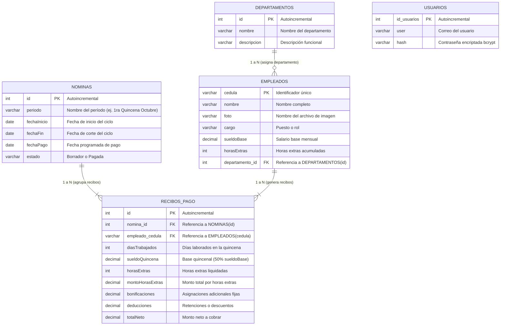

# 📊 NominaSystem

> 🎓 **Proyecto de Referencia con Fines Educativos**  
> **Asignatura:** Programación II  
> **Propósito:** Demostración práctica de una arquitectura web desacoplada (Frontend SPA + API REST Backend), Programación Orientada a Objetos (POO), persistencia relacional y buenas prácticas de desarrollo sin sobreingeniería.

---

## 📖 1. Propósito y Alcance Educativo

Este repositorio fue concebido como un **proyecto pedagógico de referencia** para estudiantes de informática y programación. Su objetivo es ilustrar:

- Cómo estructurar una **Single Page Application (SPA)** moderna y modular en JavaScript Vanilla sin depender de frameworks pesados.
- Cómo aplicar **Programación Orientada a Objetos (POO)** en el cliente mediante gestores (*controllers*) con responsabilidades bien delimitadas (`GestorEmpleados`, `GestorDepartamentos`, `GestorNominas`, `GestorRecibos`, etc.).
- Cómo diseñar y normalizar un **modelo de datos relacional** que resuelva una regla de negocio real (empleados, departamentos, nóminas por período y recibos de pago desglosados).
- La flexibilidad de trabajar con persistencia tanto en **SQLite** (local y autocontenido sin requerir servicios externos) como en **MySQL / MariaDB** (mediante contenedores Docker con phpMyAdmin).

---

## 🗄️ 2. Modelo Relacional de la Base de Datos (DER)

A continuación se detalla la estructura relacional normalizada del sistema.

### Diagrama Entidad - Relación (Mermaid)



### Descripción de Entidades y Reglas de Integridad

| Tabla | Clave Primaria (PK) | Claves Foráneas (FK) | Regla de Negocio / Integridad |
|---|---|---|---|
| **`usuarios`** | `id_usuarios` | Ninguna | Manejo de credenciales del personal administrativo con hashes `bcrypt`. |
| **`departamentos`** | `id` | Ninguna | Catálogo de áreas de la empresa. |
| **`empleados`** | `cedula` | `departamento_id` $\to$ `departamentos(id)` | Si un departamento se elimina, el empleado pasa a `NULL` (`ON DELETE SET NULL`) para no perder su historial. |
| **`nominas`** | `id` | Ninguna | Representa cada ciclo quincenal con su respectivo estado (`Borrador` / `Pagada`). |
| **`recibos_pago`** | `id` | `nomina_id` $\to$ `nominas(id)`<br>`empleado_cedula` $\to$ `empleados(cedula)` | Detalle de liquidación individual. Si se elimina una nómina o un empleado, sus recibos se eliminan en cascada (`ON DELETE CASCADE`). |

---

## 🛠️ 3. Pila Tecnológica

### Backend
- **Entorno de ejecución:** [Node.js](https://nodejs.org/) (Express.js).
- **Capa de Modelo y Persistencia:** Librería `tabla-model` con soporte dual:
  - `sqlite3-tab` para base de datos local SQLite (`db/nomina.sqlite`).
  - `mysql-tab` para base de datos MariaDB / MySQL.
- **Autenticación y Seguridad:** `bcryptjs` (hashing de contraseñas) y `jsonwebtoken` (JWT en cookies HttpOnly).
- **Procesamiento de Archivos:** `multer` para carga de imágenes en disco (`uploads/`).

### Frontend
- **Arquitectura:** Single Page Application (SPA) nativa con JavaScript moderno (ES Modules).
- **Patrón POO:** Controladores/Gestores orientados a objetos (`GestorEmpleados`, `GestorDepartamentos`, `GestorNominas`, `GestorRecibos`, `GestorEstadisticas`, `GestorReporte`).
- **Servicio de Red:** Capa centralizada con funciones limpias en `frontend/js/api.js`.
- **Notificaciones:** Clase reutilizable `Notificador` (Toast visual moderno).
- **Reportes y Gráficos:** `Chart.js` y vista imprimible formateada para exportar a PDF vía diálogo del navegador (`Ctrl + P`).

---

## 🚀 4. Puesta en Marcha (Instalación)

### Requisitos Previos
- [Node.js](https://nodejs.org/) v18 o superior.
- [Docker](https://www.docker.com/) (opcional, solo si deseas utilizar MySQL + phpMyAdmin).

### Paso 1: Clonar e Instalar Dependencias
```bash
git clone <url-del-repositorio>
cd NominaSystem
npm install
```

---

## 💾 5. Opciones de Base de Datos

El sistema está preparado para ejecutarse bajo dos modalidades según las necesidades del estudiante o evaluador:

### Opción A: SQLite (Recomendada para pruebas rápidas y locales)
No requiere Docker ni servidores externos. La base de datos se genera automáticamente en `db/nomina.sqlite` con sus semillas precargadas:

1. En [backend/server.js](backend/server.js) asegúrate de importar el conector SQLite:
   ```javascript
   const connect = require('./db.sqlite.js');
   ```
2. Inicia el servidor:
   ```bash
   npm run dev
   ```
3. Abre tu navegador en: [http://localhost:3000](http://localhost:3000)

> 💡 **Reinicio de datos en SQLite:** Para regenerar la base de datos y restablecer los datos de prueba, simplemente elimina el archivo `db/nomina.sqlite` y reinicia el servidor. La librería volverá a ejecutar el esquema DDL y las semillas iniciales.

---

### Opción B: MariaDB / MySQL con Docker y phpMyAdmin
Para entornos que simulan bases de datos en producción:

1. Levanta los contenedores:
   ```bash
   docker compose up -d
   ```
2. En [backend/server.js](backend/server.js), cambia la importación a la conexión MySQL:
   ```javascript
   const connect = require('./db.js');
   ```
3. Inicia el servidor Node:
   ```bash
   npm run dev
   ```
4. **Accesos:**
   - **Aplicación Web:** [http://localhost:3000](http://localhost:3000)
   - **phpMyAdmin (Gestor Visual de Base de Datos):** [http://localhost:8080](http://localhost:8080)  
     - **Servidor:** `basededatos`  
     - **Usuario:** `root`  
     - **Contraseña:** `root`

---

## 🔑 6. Credenciales de Prueba (Semilla Inicial)

Al arrancar por primera vez, el sistema inserta automáticamente el usuario administrador con contraseña encriptada:

- **Usuario:** `root`
- **Contraseña:** `1234`

---

## 📁 7. Estructura del Proyecto

```text
NominaSystem/
├── backend/
│   ├── db.js                 # Conexión MySQL / MariaDB (tabla-model + mysql-tab)
│   ├── db.sqlite.js          # Conexión SQLite (tabla-model + sqlite3-tab)
│   ├── server.js             # Entrada del servidor Express y configuración de rutas
│   ├── model/                # Definición de tablas y semillas (.insert)
│   │   ├── usuarios.js
│   │   ├── departamentos.js
│   │   ├── empleados.js
│   │   ├── nominas.js
│   │   └── recibos_pago.js
│   └── routes/               # Endpoints REST de la API
│       ├── auth.js
│       ├── departamentos.js
│       ├── empleados.js
│       ├── nominas.js
│       └── recibos.js
├── db/                       # Archivo local de base de datos SQLite (nomina.sqlite)
├── frontend/                 # Arquitectura SPA (HTML, CSS y JS modular)
│   ├── index.html            # Pantalla de Login
│   ├── dashboard.html        # Shell principal de la SPA
│   ├── css/                  # Estilos responsivos, temas y formato de impresión
│   ├── views/                # Fragmentos de vistas cargados dinámicamente
│   │   ├── empleados.html
│   │   ├── empleado-form.html
│   │   ├── departamentos.html
│   │   ├── nominas.html
│   │   ├── recibos.html
│   │   └── estadisticas.html
│   └── js/
│       ├── api.js            # Cliente HTTP / API Service en funciones puras
│       ├── gestores/         # Clases POO para control de cada vista
│       │   ├── GestorEmpleados.js
│       │   ├── GestorDepartamentos.js
│       │   ├── GestorNominas.js
│       │   ├── GestorRecibos.js
│       │   ├── GestorEstadisticas.js
│       │   └── GestorReporte.js
│       └── utilidades/
│           └── Notificador.js
├── bd.sql                    # Script DDL y DML de referencia para MySQL
├── docker-compose.yml        # Configuración de MariaDB y phpMyAdmin
├── icon.jpg                  # Logo / Icono del proyecto
└── README.md                 # Documentación técnica y pedagógica
```

---

## 📝 8. Licencia y Uso

Material de código abierto desarrollado exclusivamente con fines didácticos y de estudio para la materia de **Programación II**. Queda permitida su libre consulta, clonación y adaptación académica.
